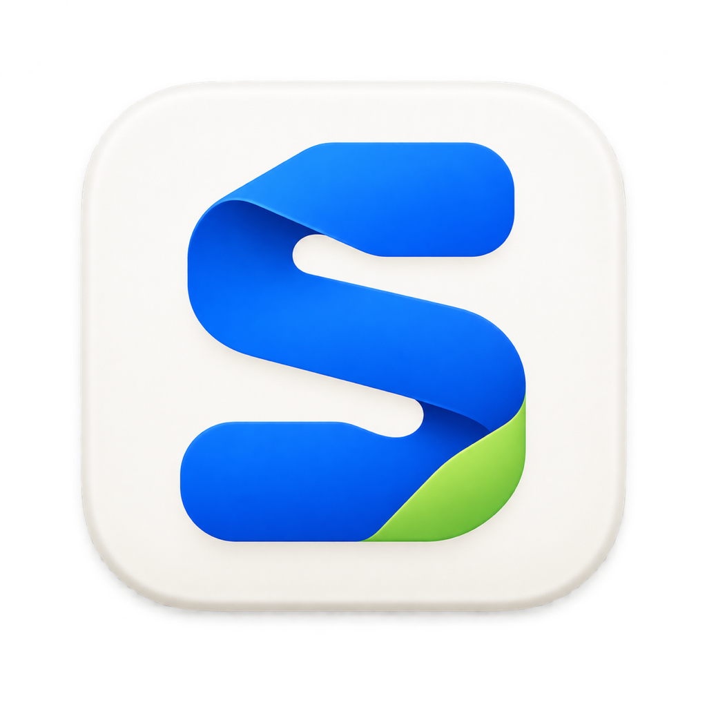
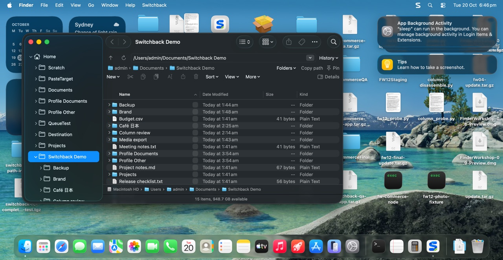
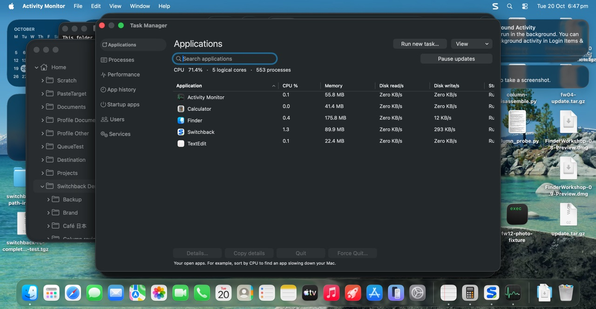
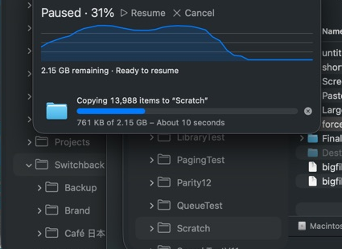
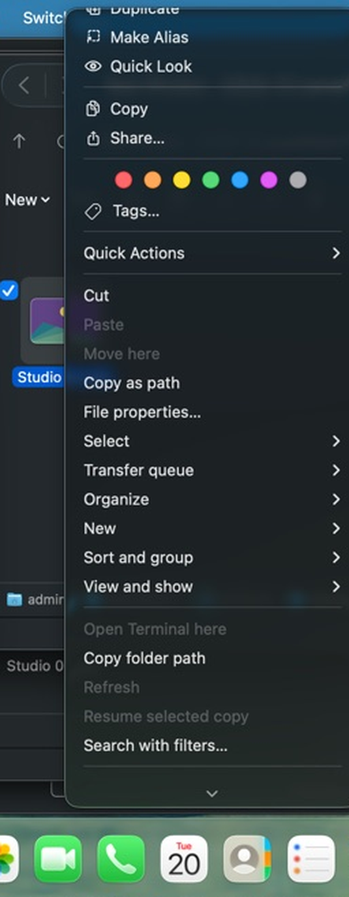

  

<h1 align="center">Switchback</h1>

<strong>The Windows features you miss. In the Mac you love.</strong>

  
  

Switchback brings Windows Explorer-style features to the real macOS Finder — no replacement file manager, no learning a new app. Your Finder windows gain an address bar, clickable breadcrumbs, an expandable folder tree, selection checkboxes, single-click options, powerful search (including inside archives), photo timelines, transfer controls with pause/resume, and a Task Manager integrated with Force Quit.

## Download

**[⬇ Download the latest release](https://github.com/gshipman223/switchback/releases/latest)**

Also available at [getswitchback.io/downloads](https://getswitchback.io/downloads/Switchback-0.23.dmg).

The DMG is Developer ID signed and notarised by Apple — it opens with no Gatekeeper warnings. Verify (optional): SHA-256 is listed on the release page.

> **Current status:** On sale at [getswitchback.io](https://getswitchback.io). A 14-day trial needs no card. One Mac is $24.99 USD, and each extra Mac is $8.99 on the same licence key.

## Requirements

- Apple silicon Mac
- macOS 26 (build 25G83)
- One-time setup step in Recovery (guided in-app, fully reversible)

## Highlights

- **Address bar & breadcrumbs** — type or paste a path, click any parent folder
- **Expandable folder tree** in Finder's own sidebar
- **Selection checkboxes & single-click** options
- **Search everywhere** — current folder, whole Mac, inside ZIP/archives
- **Photo Timeline** — browse photos by year and month
- **Transfers** — pause, resume and queue Finder copies and moves

- **Task Manager** — CPU/memory per app, integrated with native Force Quit
- **Default Apps** — set default apps by file type, with undo

## Expanded right-click menu

Finder's own menu stays (Quick Actions, Open With, extensions). Switchback adds the Explorer commands you reach for:

- **New ▸** Folder · Text document · Markdown · CSV · JSON · Folder with selection · Smart Folder · Tab · Window
- **Organize ▸** Rename · Duplicate · Make Alias · Compress · Compress with password… · Move to Bin · Tags… · Add to Sidebar
- **Everyday:** Cut · Paste · Move here · Copy as path · File properties…
- **Transfer queue ▸** Copy to… · Move to… · Open transfer queue
- **Select ▸** Select all · Unselect all · Invert selection
- **Sort and group ▸** · **View and show ▸**
- Open Terminal here · Copy folder path · Refresh · Resume selected copy · Search with filters…

A command bar above your files also keeps New, Cut, Copy, Paste, Rename, Share, Bin, Sort and View one click away.

## Pricing

One payment, no subscription:

- **$24.99 USD** for one Mac
- **$8.99 USD** for each extra Mac, added to the same licence key
- 14-day free trial, no card required (starts only once Finder connects)
- **12 months of updates** included

Licence details: [getswitchback.io/pricing](https://getswitchback.io/pricing/)

## Support

- Setup guide: [getswitchback.io/setup](https://getswitchback.io/setup/)
- Support & help: [getswitchback.io/support](https://getswitchback.io/support/)
- Bug reports: [GitHub Issues](https://github.com/gshipman223/switchback/issues)

## About this repository

This is Switchback's public home for downloads, release notes and support. Switchback is commercial software developed in a private repository — the source code is not published. Found Switchback useful? ⭐ **Star this repo** to follow releases.

Independent software. Not affiliated with Apple or Microsoft.
